# Chapter 7 Basic Types

In this chapter we discuss the rest of the basic type in **C99**
as we have discussed the basic (built-in) types: 
- `int`
- `float`


## 7.1 Integer Types

The integer types are divided into two categories:

- Sign
- Unsigned

### sign Bit
The leftmost bit of a signed integer which is known as the ***signed bit***
is:
- `0` if the number is positive or zero 
- `1` if it is negative 

example of the largest 17 bit integer has the binary representation of:
`0111111111111111` which is `32,767` (2<sup>15</sup> - 1).

By default, integer variables are signed in C 

The leftmost bit is reserved for the sign which tells the compiler that a 
variable has no sign bit,

Unsigned numbers are useful for system programming and low-level machine dependent 
applications. 

C provides `long` integers which are numbers that is too large to be stored 
in a `int` variable.
            
`short` integers is used when we may need to conserver memory by instructing the compiler 
to store a number in less space than normal. 

To construct an integer type we can specify that a variable is `long` or `short signed`
or `unsigned`. 

Here below are the six combination to produce different types:

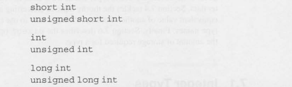

The range of values represented by each of the six integer types varies from one machine
to another.

Here below is a table to show the usual range of values for integer types on machine:

#### 16-bit machine:


 

#### 32-bit machine:

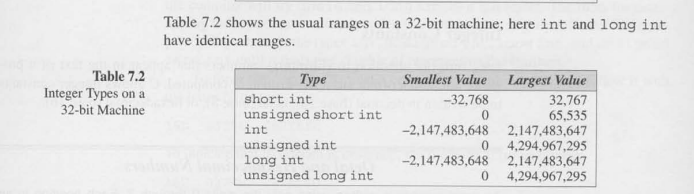

#### 64-bit machine:


The ranges shown are not mandated by the C standard and may vary from one compiler to another
so one way to determine is to use:
`<limits.h>` header which defines macros that represent the smallest and largest values for each 
integer type


### Integer types in C99

In C99 provides two additional standard integer types:
- `long long int`
- `unsigned long long int`

Primary used for to support 64-bit machines and their capability of using very large numbers 
  
#### Standard Signed Integer Types in C99 
- `short int`
- `int`
- `long int`
- `long long int`

#### Standard Unsigned Integer Types in C99  
- `unsigned short int`       
- `unsigned int`                     
- `unsigned long int`        
- `unsigned long long int` 
- `unsigned char`
- `_Bool`


### Integer Constants

***Constants*** are numbers that appear in the text of a program, not numbers that are read,written
or computed in C. 

It allows integer constants to be written in:
- Decimal (base 10)
- Octal (base 8)
- Hexadecimal (base 16)


#### Decimal Constant

Contains digits between `0` and `9` but must not begin with a zero:
- `15`
- `255`
- `32767`

#### Octal Constant 

Contains only digits between `0` and `7` and must begin with a zero:
- `017`
- `0377`
- `023333`

Each position in an octal number represents a power of 8 thus an octal number of
237 represents the decimal number: 

**(2 * 8<sup>2</sup>) + (3 * 8<sup>1</sup>) + (7 * 8<sup>0</sup>) = 128 + 24 + 7 = 159**
 

#### Hexadecimal Constant

Contains digits between `0` and `9` and letters between `a` and `f` and always begins with
`0x` and can be either uppercase or lowercase:
- `0xf`
- `0xff`
- `0x7fff`


The letters `A` through `F` which stands for `10` through `15` in decimal format and
each position in a hex number represents a power of 16.

So the hex number `1AF` has the decimal value of:

**(1 * 16<sup>2</sup>) + (10 * 16<sup>1</sup>) + (15 * 16<sup>0</sup>) = 256 + 160 + 15 = 431** 
          

Reminder that octal and hexadecimal are nothing more than alternative way of writing numbers and have no effect on how 
numbers are actually stored as integers are always stored in binary regardless of what notation we used to express them.


You can force the compiler tyo treat a constant as different types of int by representing them with letters:

- `long` constant -  `15L`, `0377L`, `0x7ffL`


- `unsigned` constant - `15U`, `0377U`, `0x7ffU`


- `long` and `unsigned` constant - `OxffffffffUL`


- C99 has `LL` AND `ULL` types  


### Integer Overflow
         
When an arithmetic operation are performed on integers it is possible that the result will be too large 
to represent this means an ***overflow*** has occurred.
              
Overflow occurs depends on whether the operands were signed or unsigned

When overflow happens during an operation on a signed integer, the program behavior is `undefined`.

When overflow happens during an operation on an unsigned integer though the result is `defined` we get the 
correct answer which is:

modulo ***2<sup>n</sup>*** where  ***n*** is the number of bits used to store the result.

### Reading and Writing Integers
    
When reading or writing an `unsigned` integer use the letter:
- `u` - decimal (base 10)
- `o` - octal (base 8)
- `x` - hexadecimal (base 16)


                             
When reading or writing a `short` integer, put the letter:
- `h` in front of `d`, `o`, `u` or `x`

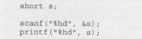
  

When reading or writing `long` integer, put the letter:
- `l` in front of `d`, `o`, `u` or `x`

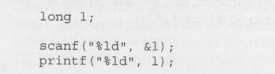
                          
When reading or writing `long long` integer (C99 Only), put the letter:
- `ll` in front of `d`, `o`, `u` or `x`          

 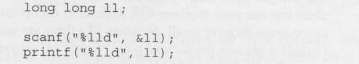


## 7.2 Floating types

C provides three ***floating types*** corresponding to different floating-point formats:
- `float`        - Single-precision floating point 


- `double`       - Double-precision floating point   


- `long double`  - extended-precision floating point     
      
### The IEEE Floating-Point Standard

They provide two primarily formats for floating-pont numbers:
- single-precision (32 bits)
- double-precision (64 bits)

Numbers are stored in a form of scientific notation each number having three parts:
- **Sign** - (1 bit)
- **exponent** - (8 bits long 1 byte)
- **Fraction** - (23 bits long)  

A single precision number has a maximum value of approx 
***3.40 * 10<sup>38</sup>*** with a precision of about 6 decimals


The Table below shows the characteristics of the floating types when implemented
according to the ***IEEE Standard*** 

(The table shows the smallest positive ***normalized value***, subnormal numbers can be smaller).

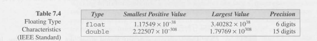

Macros that define the characteristics of the floating types can be found at
`<float.h>` header

### C99 Floating Types

In C99 floating types are divided into two categories.
   
The ***Real Floating Types***:
- The `float` 
- The `double` 
- the `long double`
  
The ***Complex Types*** (new to C99):
- `float _Complex`
- `double _Complex`
- `long double _Complex`


### Floating Constants

Floating constant can be written in various ways, an example is the following constant
`57.0`:

- `57.0`


- `57.`


- `57.0e0`


- `57E0`


- `5.7el`


- `5.7e+1`


- `.57e2`


- `570.e-1`

By default, floating constant are stored as double-precision numbers in other words when a C
compiler finds the constant `57.0` in a program, it arranges for the number to be stored in memory in the same format
as a `double` variable.

 To indicate that only a single-precision is desired we can put the letter `F` or (`f`) at the end of the constant
an example is: `57.0f` to show it should be stored in a float format. 


### Reading and Writing Floating-Point Numbers

`%e`, `%f`, and `%g` are used for reading and writing single-precision floating point numbers (from chapter 3)
  
When reading a value of type `double`, put the letter:
- `l` in front of `e`, `f` or `g`


When reading or writing value of type `long long double` put the letter:
- `L` in front of `e`, `f` or `g`
      
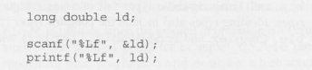


       

## 7.3 Character Types 

The most popular character set is **ASCII** (American Standard Code for information interchange)
          
It is a 7-bit code capable of representing `128` characters. 

In ASCII the digits `0-9`  are represented by the codes:
- `0110000-0111001 `

The uppercase letters `A-Z` are represented by the codes:
- `1000001-1011010`

ASCII is often extended to a 256-character code known as ***Latin-1***

Here below is how to assign a `char` variable:

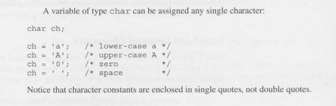

### Operations on Characters

C treats characters as small integers as characters are encoded in binary.

In ASCII a character code ranges from `0000000 to 1111111` which we can think of as integers
from `0 to 127` integers. 

So an example is that characters:
- `'a'` has the value of `97` 
- `A` has the value of `65`
- `'o'` has the value of `48`
- `' '` has the value of `32` (space)


The connection between characters and integers in C are so strong that characters constant actually
have an `int` type rather than a `char` type 

When a `char` appears in computation, C simply uses its integer value 

Consider this example below which assumes the ASCII character set:


Characters can also be compared just as numbers can. 

The following `if` statement checks whether `ch` contains a lower-case, and if so it will convert `ch`
to uppercase:

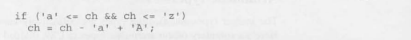

We can easily write a `for` statement whose control variable steps through all the upper-case letters:

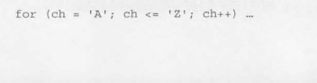
                                        
 
### Signed and Unsigned Characters

Since C allows characters to be used as integers, it should not be surprising that the 
`char` type exist in both ***signed*** and ***unsigned*** versions.

- Signed characters have values between `-128 and 127`
- Unsigned characters have values between `0 and 255`

C standard does not specify whether ordinary `char` is signed or unsigned type
as some compiler treat is one or the other.

We should not care whether `char` is signed or unsigned unless if we're using a character variable to store a 
small integer.

 
- C89 uses the term ***Integral types*** to refer to both integer types and the character types. Enumerated types are also
  integral types.


- C99 does not use the term ***"Integral types"*** instead it expands the meaning of ***"integer types"*** to include the 
  Character types and the enumerated types. C99 `_Bool` type is also to be unsigned integer type. 

     
 
### Arithmetic type

The integer types and floating types are collectively known as ***arithmetic types*** and here below is 
a summary of the arithmetic type in C89

#### Integral types: 

- `char`


- signed integer types (`signed char`, `short int `,`int`,`long int`)
     

- Unsigned integer types (`unsigned  char`, `unsigned short int`,` unsigned int`,` unsigned long int`) 
   

- Enumerated types


#### Floating types:

- (`float`, `double`, `long double`)


C99 has a more complicated hierarchy for its arithmetic types:

#### Integer types:

- `char`

                                                                                          
- signed integer types, both standard (`signed char`, `short int `,`int`,`long int`, `long long int`)  and extended                            
                                                                                              
                                                                                              
- unsigned integer types, both standard (`unsigned  char`, `unsigned short int`,` unsigned int`,` unsigned long int`, `unsigned long long int , _Bool`) and extended
 

- Enumerated types 


#### Floating types: 

- Real floating types (`float`, `double`, `long double`) 


- Complex types (`float_Complex`, `double _Complex`, `long double _Complex`)

### Escape sequence

There are two kinds of escape sequences:

- Character escapes
- Numeric escapes

Here below is the complete set of escape sequences:


  
To write a numeric escape for a particular character we first look up the characters octal or hexadecimal value
in a table 

an Example the ASCII escape character (decimal value: `27`) has the value of `33` in octal and
`1B` in hex. So either of the code can be used to write an escape sequence:

#### Octal escape sequence:

- consist of the `\` character followed by an octal number with at most three digits


- this number must be represented as an unsigned character so its maximum value is normally `377` octal


- An example is the escape characters could be written as `\33` or `\033`


- Octal do not have to begin with `0`

#### Hexadecimal escape sequence:

- Consist of `\x` followed by a hexadecimal number


- C places no limit on the number of digits in the hexadecimal number so it must be representable as an unsigned character
    

- Hence, it can not exceed `FF`, if the characters are eight bits long


- Using this notation, the escape characters would be written as `\x1b` or `\x1B`


- The `x` must be in lowe case but the hex digit such as `b` can be upper or lower case.


When using a character constant, an escape sequence must be enclosed in single quotes, for example:

A constant representing the escape characters would be written as `\33`. They tend to look a bit cryptic and hard to read
So the solution it to give them a names using `#define`

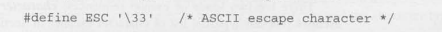


### Character-Handling Functions 

A better way to handle converting a case is to call C's `toupper()` function:

```
ch = toupper(ch)  /* converts ch to upper case */
```

- When it is called, `toupper()` checks whether its argument in this case `ch` is a lower-case letter.
- If so then it returns the corresponding upper-case letter.
- Otherwise `toupper()` returns the value of the argument.

We can also store in another variable or test it in an `if` statement below:

```
char x = toupper(ch)

if (toupper(ch) == `A`)...
```

Programs will need to have the following `#include` directive to use `toupper()` function:

```
#include <ctype.h>
```


### Reading and Writing Characters using `scanf` and `printf`

To read and write single characters we use the `%c` conversion specifier:

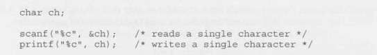

`scanf` does not skip white-space characters before reading a character.

If the next unread character is a space then the variable `ch` in the previous example will contain a space
after the `scanf` returns

To Force `scanf` to skip white space before reading a character, we put a space in its format string just before `%c` 
shown below:

```
scanf (" %c", &ch); /* skips white space, then reads ch */
```

To recall Section 3.2 a blank in a `scanf` format string means:

***"skip zero or more white-space characters"***

Since `scanf` does not normally skip white spaces it is easy to detect the end of an input line: check to see if the character
just read is the new-line character.


### Reading and Writing Characters using `getchar` and `putchar`

C provides a better way to read and write single characters.

We can use the `getchar` and `putchar` functions instead of `scanf` `printf`

`putchar` writes a single character:

```
putchar(ch);
```

Each time `getchar` is called it reads one character which I return and in order to save the character we must 
assign it to store it into a variable:

```
ch = getchar(); /* reads a character and stores it in ch */
```

The `getchar` actually returns an `int` value rather than a `char` value.

So it is not unusual for a variable to have type `int` rather than `char`
if it will be used to store character read by `getchar`

Like `scanf`, `getchar` does not skip white-spaces characters as it reads.


#### Using `getchar` and `putchar` saves time for two reasons:

- when the program is executed as `scanf` and `printf` are designed to read and write many kinds of datra in variety of format


- `getchar` and `putchar` are usually implemented as macros for additional speed


`getchar` has another advantage over `scanf` as it returns the character that it reads, and it lends itself to 
various C idioms Meaning things like loops that search for a character or skip over 
all occurrences of a character 

consider these `scanf` loop and then a `getchar` loop:

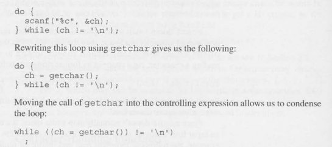


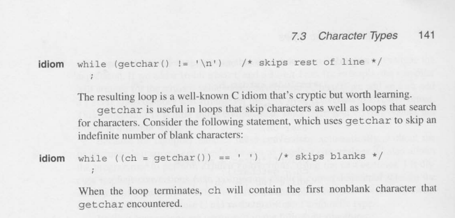


## 7.4 Type Conversion

Computer can preform an arithmetic operation if the operands 
are of the same size meaning the same number of bits and be 
stored in the same way

So a computer may be able to add two 16-bit integer directly 
but not a 16-bit integer and 32-bit integer or a 32-bit 
integer and a 32 bit floating point number

C however can allow basic types to be mixed in expressions and 
can combine integers, floating point numbers and even characters in a single 
expressions.

if we add a 16 bit `short` and a 32-bit `int` the compiler 
will arrange for the `short` value to be converted to 
32 bits `int`.

so an example if we add an `int` and `float`, the compiler 
will arrange for the `int` to be converted to a `float` 
format. Because the compiler handle this conversion automatically 
without you the programmer involvement they are known as:

***Implicit Conversion!*** 

C also has ***explicit Conversion***  using the **cast** operator.


#### Implicit Conversion are preformed in the following situations:

- When the operands in an arithmetic or logical expression do not have the 
  same type (C preforms what is known as **usual arithmetic conversion**)


- When the type of the expression on the right side of an 
  assigment doe not math the type of the variable on the 
  left side


- When the type of argument in a function call does not 
  match the type of the corresponding parameter.


- When the type of the expression in a `return` statement 
  does not math the function return type.

(the last two is saved for chapter 9 - functions)

#### The Usual Arithmetic Conversion 

- The usual arithmetic conversion are applied to the operand of most binary operators including,
the arithmetic, relational and equality operators.


- So an example is if we have `float f` and `int i` and want to add both numbers
`f + i`


- The type are not the same so it's safe to convert `i` to `float` rather the other way around
The reason is obvious; the lost of precision.


- The strategy behind the usual arithmetic conversion is to convert operands to the ***"Narrowest"*** type 
that will safely accommodate both values.
**(Roughly speaking, one type is narrower than another if it requires fewer bytes to store).**

The types of the operands can often be made to match by converting the operand of the narrower type to the type of the other operand 
is known as ***Promotion***

The most common promotion are the ***Integral Promotion*** which converts a character or `short` integer to type `int`
 or to `unsigned int` in some cases. 

#### We can divide the rules for preforming the usual arithmetic conversion into two cases:

**The type of either operand is a floating type**

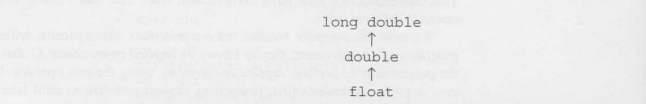

**Neither operand type is a floating type**

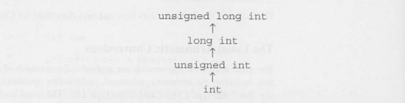


**Here below is an example of the usual arithemetic conversions:**

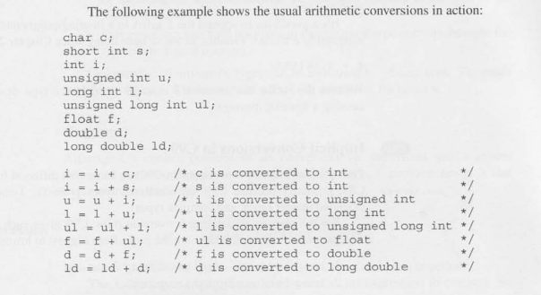


#### Conversion During Assignment 

The usual arithmetic does not apply to assignment and instead C follow the simple rule that the 
expression on the right side of the assigment is converted to the type of the variable on the left side

If the variable is at least **"Wide"** as the expression itself, this will work simply,
shown below:

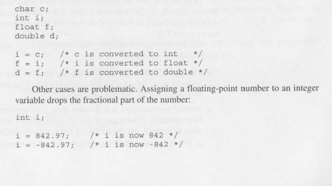


#### Implicit conversion in C99

The rules for implicit is different from C90 as C99 has additional types,
Here are the ranks from highest to lowest conversion:

1. `long long int, unsigned long long int`
2. `long int, unsigned long int`
3. ` int, unsigned int`
4. `short int, unsigned short int`
5. `char, signed char, unsigned char`
6. `_Bool`


For simplicity, I have ignored the extended integer types and enumerated types here.

In C99 we have ***"Integer promotion"*** instead of C89 integral promotions. Which is basically
converting any type whose rank is less than `int` and `unsigned int` to `int`

Provided that all vales of the type can be represented using `int`

**The type of either operand is a floating type:**

- As long as neither operand has a complex type, the rules are the same as before

**Neither operand type is a floating type**:

- First: preform integer promotion on both operands


- Second: if the type of the two operands are now the same


- Third: The process ends

Fourth: Otherwise, use the following rules, stopping at the first one that applies:

1. If both operands have signed types or both have unsigned types convert the operand whose type has lesser integer conversion rank to 
      the type of the operand with greater rank. 


2. If the unsigned operand has a rank greater or equal to the rank of the type of the signed operand, convert the signed operand to the type 
      of the unsigned operand. 
   

3. If the type of the signed operand can represent all the values of the type of the unsigned operand, convert the unsigned operand to 
   the sign operand.
   
   
4. Otherwise, convert both operands to the unsigned type corresponding to the type of the signed operand.


### Casting

C provides ***casts*** which has the expression form as:

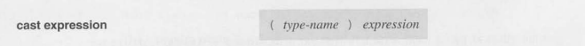

`type-name` specifies the type to which the expression should be converted.

The example below shows us how to case an expression to compute the fractional 
part of a `float` value:

```
float f, frac_part;
frac_part = f - (int) f;
```

The cast expression `(int) f` represents the result of converting the value of `f` to type `int`

Cast expression enables us to document type conversion that would take place anyway:

```
i = (int) f; /* f is converted to int */
```

This also enables us to overrule the compiler and force it to do conversion that we want.

consider this example below:

```
float quotient;
int dividend, divisor;
quotient = dividend / divisor;
```

- As is written the result of the division which is an `int` will be converted to a 
  `float`form before being stored in a `quotient`.

- We probably want `dividend` and `divisor` to be converted to `float` before the division.

- So that we get a more exact answer 

So a cast expression will do the trick:

```
quotient = (float) dividend / divisor;
```

The `divisor` does not need a cast since casting `dividend` to a `float` 
forces the compiler to convert `divisor` to a `float` also.

C regards `(type-name)` as a unary operator and unary operator have a higher precedence
than binary operators so the compiler interprets it as:
```
(float) dividend / divisor

// as

((float) dividend) / divisor
```

## 7.5 Type Definitions

There is a better way to set up Boolean type using a feature known as ***type definitions***:

```
typedef int Bool;
```
The name of the type being defined comes last and also that I have capitalized 
the word `Bool`. Capitalizing the first letter is just a convention that 
C programmers employ.

Using `typedef` to define `Bool` can now be used in the same way as the built-in type names in
variable declarations, cast expressions and elsewhere in your program


### Advantages of Type Definitions 

Type definitions can make the program more readable and understandable as for example,
we had a variables called `cash_in` and `cash_out` that will be used to store dollar amounts.
Declaring `Dollars` as:

```
typedef float Dollars;
```

Then writing:

```
Dollars cash_in, cash_out;
```

it is more readable and understandable than just writing:

```
float cash_in, cash_out;
```

Type definition can make a program easier to modify as if we later decide that Dollars should be really define as a `double`,
all we need to change is the type definition:

```
typedef double Dollars
```


## Type Definitions and Portability

It's an important tool for writing portable programs as moving from one computer to another is that types may have different ranges on different 
machines as again changing the type is as just changing the `typedef` of said type variable.

However, changing the definition may affect the `scanf` and `printf` conversion specification,
So C library itself uses `typedef` to create names for types that can vary from one C implementation to another.

These types often have names that end with `_t` such as:
- `ptrdiff_t`
- `size_t`
- `wchar_t`

Here are some typical examples:

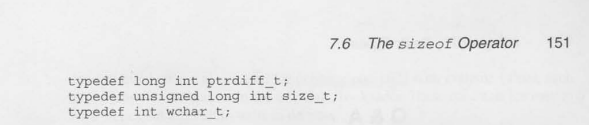


In C99 the `<stdint.h>` header uses typedef to define names for integer types with particular number of bits.
For example:

`int32_t` is a signed integer type with exactly 32 bits. Using these types is an effective way to make programs more portable.


## 7.6 The `sizeof` Operator


The `sizeof` operator allows a program to determine how much memory is required to store
values of a particular type. The value of the expression is shown below:

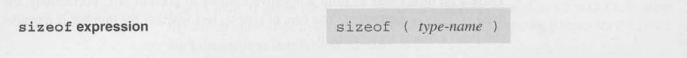

- `size(char)` is always 1 but the sizes of the other types may vary


- 32-bits machine, `sizeof(int)` is normally `4`.


- The `sizeof` can be applied to constants, variables and expressions


- Note that `sizeof` is rather unusual operator, since compiler itself can usually 
  determine the value of a `sizeof` expression.


- Printing `sizeof` value require care as the type of `sizeof` expressions is an 
  implementation-defined type named `size_t`


- In c89 it is best to convert the value of the expression to a 
  known type before printing it as `size_t` is guaranteed to be a `unsigned` integer type 


  
- In C99 the `size_t` type can be larger than `unsigned long` 


- However, the `printf` function in C99 is capable of displaying `size_t`
  Values directly without needed a cast. 


- The trick is to use the letter `z` in the conversation specification followed by one   of the usual integer code (typically `u`).

```
printf("Size of int: %zu\n", sizeof (int)); /* C99 only */
```


