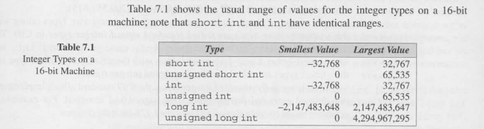

# Chapter 7 Basic Types

In this chapter we discuss the rest of the basic type in **C99**
as we have discussed the basic (built-in) types: 
- `int`
- `float`

## 7.1 Integer Types

The integer types are divided into two categories:

- Sign
- Unsigned

#### sign Bit
The leftmost bit of a signed integer which is known as the ***signed bit***
is:
- `0` if the number is positive or zero 
- `1` if it is negative 

example of the largest 17 bit integer has the binary representation of:
`0111111111111111` which is `32,767` (2 to the power 15 - 1).

By default, integer variables are signed in C 

The leftmost bit is reserved for the sign which tells the compiler that a 
variable has no sign bit,

Unsigned numbers are useful for system programming and low-level machine dependent 
applications. 

C provides `long` integers which are numbers that is too large to be stored 
in a `int` variable.
            
`short` integers is used when we may need to conserver memory by instructing the compiler 
to store a number in less space than normal. 

To construct an integer type we can specify that a variable is `long` or `short signed`
or `unsigned`. Here below are the six combination to produce different types.

The range of values represented by each of the six integer types varies from one machine
to another.

Here below is a table to show the usual range of values for integer types on machine:

#### 16-bit machine

 

#### 32-bit machine

#### 64-bit machine  

The ranges shown are not mandated by the C standard and may vary from one compiler to another
so one way to determine is to use:
`<limits.h>` header which defines macros that represent the smallest and largest values for each 
integer type

### Integer types in C99

In C99 provides two additional standard integer types:
- `long long int`
- `unsigned long long int`

Primary used for to support 64-bit machines and their capability of using very large numbers 
  
#### Standard Signed Integer Types in C99 
- `short int`
- `int`
- `long int`
- `long long int`

#### Standard Unsigned Integer Types in C99  
- `unsigned short int`       
- `unsigned int`                     
- `unsigned long int`        
- `unsigned long long int` 
- `unsigned char`
- `_Bool`

### Integer Constants

***Constants*** are numbers that appear in the text of a program, not numbers that are read,written
or computed in C. 

It allows integer constants to be written in:
- Decimal (base 10)
- Octal (base 8)
- Hexadecimal (base 16)

#### Decimal Constant

Contains digits between `0` and `9` but must not begin with a zero:
- `15`
- `255`
- `32767`

#### Octal Constant 

Contains only digits between `0` and `7` and must begin with a zero:
- `017`
- `0377`
- `023333`

Each position in an octal number represents a power of 8 thus an octal number of
237 represents the decimal number: 

(2 * 82) + (3 * 81) + (7 * 80) = 128 + 24 + 7 = 159
 

#### Hexadecimal Constant

Contains digits between `0` and `9` and letters between `a` and `f` and always begins with
`0x` and can be either uppercase or lowercase:
- `0xf`
- `0xff`
- `0x7fff`

The letters `A` through `F` which stands for `10` through `15` in decimal format and
each position in a hex number represents a power of 16.

So the hex number `1AF` has the decimal value of:

(1 * 162) + (10 * 161) + (15 * 160) = 256 + 160 + 15 = 431   
          

Reminder that octal and hexadecimal are nothing more than alternative way of writing numbers and have no effect on how 
numbers are actually stored as integers are always stored in binary regardless of what notation we used to express them.

You can force the compiler tyo treat a constant as different types of int by representing them with letters:

- `long` constant -  `15L`, `0377L`, `0x7ffL`

- `unsigned` constant - `15U`, `0377U`, `0x7ffU`

- `long` and `unsigned` constant - `OxffffffffUL`

- C99 has `LL` AND `ULL` types  

### Integer Overflow
         
When an arithmetic operation are performed on integers it is possible that the result will be too large 
to represent this means an ***overflow*** has occurred.
              
Overflow occurs depends on whether the operands were signed or unsigned

When overflow happens during an operation on a signed integer, the program behavior is `undefined`.

When overflow happens during an operation on a unsigned integer though the result is `defined` we get the 
correct answer which is:

modulo ***2n*** where  ***n*** is the number of bits used to store the result.

### Reading and Writing Integers
    
When reading or writing an `unsinged` integer use the letter:
- `u` - decimal (base 10)
- `o` - octal (base 8)
- `x` - hexadecimal (base 16)

                             
When reading or writing a `short` integer, put the letter:
- `h` in front of `d`, `o`, `u` or `x`
  

When reading or writing `long` integer, put the letter:
- `l` in front of `d`, `o`, `u` or `x`
                          
When reading or writing `long long` integer (C99 Only), put the letter:
- `ll` in front of `d`, `o`, `u` or `x`          

 

## 7.2 Floating types

C provides three ***floating types*** corresponding to different floating-point formats:
- `float`        - Single-precision floating point 

- `double`       - Double-precision floating point   

- `long double`  - extended-precision floating point     

