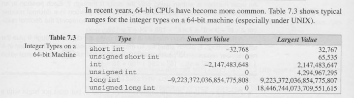
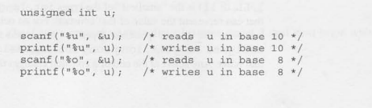
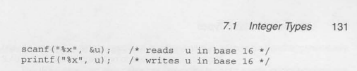
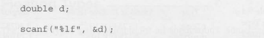
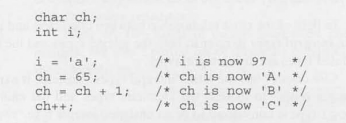
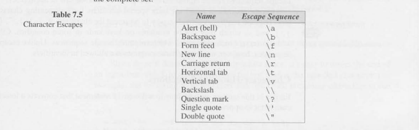

# Chapter 7 Basic Types

In this chapter we discuss the rest of the basic type in **C99**
as we have discussed the basic (built-in) types: 
- `int`
- `float`

## 7.1 Integer Types

The integer types are divided into two categories:

- Sign
- Unsigned

#### sign Bit
The leftmost bit of a signed integer which is known as the ***signed bit***
is:
- `0` if the number is positive or zero 
- `1` if it is negative 

example of the largest 17 bit integer has the binary representation of:
`0111111111111111` which is `32,767` (2 to the power 15 - 1).

By default, integer variables are signed in C 

The leftmost bit is reserved for the sign which tells the compiler that a 
variable has no sign bit,

Unsigned numbers are useful for system programming and low-level machine dependent 
applications. 

C provides `long` integers which are numbers that is too large to be stored 
in a `int` variable.
            
`short` integers is used when we may need to conserver memory by instructing the compiler 
to store a number in less space than normal. 

To construct an integer type we can specify that a variable is `long` or `short signed`
or `unsigned`. Here below are the six combination to produce different types.

The range of values represented by each of the six integer types varies from one machine
to another.

Here below is a table to show the usual range of values for integer types on machine:

#### 16-bit machine

 

#### 32-bit machine

#### 64-bit machine  

The ranges shown are not mandated by the C standard and may vary from one compiler to another
so one way to determine is to use:
`<limits.h>` header which defines macros that represent the smallest and largest values for each 
integer type

### Integer types in C99

In C99 provides two additional standard integer types:
- `long long int`
- `unsigned long long int`

Primary used for to support 64-bit machines and their capability of using very large numbers 
  
#### Standard Signed Integer Types in C99 
- `short int`
- `int`
- `long int`
- `long long int`

#### Standard Unsigned Integer Types in C99  
- `unsigned short int`       
- `unsigned int`                     
- `unsigned long int`        
- `unsigned long long int` 
- `unsigned char`
- `_Bool`

### Integer Constants

***Constants*** are numbers that appear in the text of a program, not numbers that are read,written
or computed in C. 

It allows integer constants to be written in:
- Decimal (base 10)
- Octal (base 8)
- Hexadecimal (base 16)

#### Decimal Constant

Contains digits between `0` and `9` but must not begin with a zero:
- `15`
- `255`
- `32767`

#### Octal Constant 

Contains only digits between `0` and `7` and must begin with a zero:
- `017`
- `0377`
- `023333`

Each position in an octal number represents a power of 8 thus an octal number of
237 represents the decimal number: 

(2 * 82) + (3 * 81) + (7 * 80) = 128 + 24 + 7 = 159
 

#### Hexadecimal Constant

Contains digits between `0` and `9` and letters between `a` and `f` and always begins with
`0x` and can be either uppercase or lowercase:
- `0xf`
- `0xff`
- `0x7fff`

The letters `A` through `F` which stands for `10` through `15` in decimal format and
each position in a hex number represents a power of 16.

So the hex number `1AF` has the decimal value of:

(1 * 162) + (10 * 161) + (15 * 160) = 256 + 160 + 15 = 431   
          

Reminder that octal and hexadecimal are nothing more than alternative way of writing numbers and have no effect on how 
numbers are actually stored as integers are always stored in binary regardless of what notation we used to express them.

You can force the compiler tyo treat a constant as different types of int by representing them with letters:

- `long` constant -  `15L`, `0377L`, `0x7ffL`

- `unsigned` constant - `15U`, `0377U`, `0x7ffU`

- `long` and `unsigned` constant - `OxffffffffUL`

- C99 has `LL` AND `ULL` types  

### Integer Overflow
         
When an arithmetic operation are performed on integers it is possible that the result will be too large 
to represent this means an ***overflow*** has occurred.
              
Overflow occurs depends on whether the operands were signed or unsigned

When overflow happens during an operation on a signed integer, the program behavior is `undefined`.

When overflow happens during an operation on a unsigned integer though the result is `defined` we get the 
correct answer which is:

modulo ***2n*** where  ***n*** is the number of bits used to store the result.

### Reading and Writing Integers
    
When reading or writing an `unsinged` integer use the letter:
- `u` - decimal (base 10)
- `o` - octal (base 8)
- `x` - hexadecimal (base 16)

                             
When reading or writing a `short` integer, put the letter:
- `h` in front of `d`, `o`, `u` or `x`

  

When reading or writing `long` integer, put the letter:
- `l` in front of `d`, `o`, `u` or `x`

                          
When reading or writing `long long` integer (C99 Only), put the letter:
- `ll` in front of `d`, `o`, `u` or `x`          

 

## 7.2 Floating types

C provides three ***floating types*** corresponding to different floating-point formats:
- `float`        - Single-precision floating point 

- `double`       - Double-precision floating point   

- `long double`  - extended-precision floating point     
      
### The IEEE Floating-Point Standard

They provide two primarily formats for floating-pont numbers:
- single-precision (32 bits)
- double-precision (64 bits)

Numbers are stored in a form of scientific notation each number having three parts:
- **Sign** - (1 bit)
- **exponent** - (8 bits long 1 byte)
- **Fraction** - (23 bits long)  

A single precision number has a maximum value of approx 
***3.40 * 1038*** with a precision of about 6 decimals

The Table below shows the characteristics of the floating types when implemented
according to the ***IEEE Standard*** 

(The table shows the smallest positive ***normalized value***, subnormal numbers can be smaller).

Macros that define the characteristics of the floating types can be found at
`<float.h>` header

### C99 Floating Types

In C99 floating types are divided into two categories.
   
The ***Real Floating Types:
- The `float` 
- The `double` 
- the `long double`
  
The ***Complex Types*** (new to C99):
- `float _Complex`
- `double_Complex`
- `long double_Complex`

### Floating Constants

Floating constant can be written in various ways, an example is the follwoing constant
`57.0`:

- `57.0`

- `57.`

- `57.0e0`

- `57E0`

- `5.7el`

- `5.7e+1`

- `.57e2`

- `570.e-1`

By default, floating constant are stored as double-precision numbers in other wordds when A C
compiler finds the constant `57.0` in a program, it arranges for the number to be stored in memory in the same format
as a `double` variable.

 To indicate that only a single-precision is desired we can put the letter `F` or (`f`) at the end of the constant
an example is: `57.0f` to show it should be stored in a float format. 

### Reading and Writing Floating-Point Numbers

`%e`, `%f`, and `%g` are used for reading and writing single-precision floating point numbers (from chapter 3)
  
When reading a value of type `double`, put the letter:
- `l` in front of `e`, `f` or `g`

When reading or writing value of type `long long double` put the letter:
- `L` in front of `e`, `f` or `g`
      

       

## 7.3 Character Types 

The most popular character set is ***ASCII** (American Standard Code for information interchange)
          
It is a 7-bit code capable of representing `128` characters. 

In ASCII the digits `0-9`  are represented by the codes:
- `0110000-0111001 `

The uppercase letters `A-Z` are represented by the codes:
- `1000001-1011010.`

ASCII is often extended to a 256-character code known as ***Latin-1***

Here below is how to assign a `char` variable:

### Operations on Characters

C treats characters as small integers as characters are encoded in binary.

In ASCII a character code ranges from `0000000 to 1111111` which we can think of as integers
from `0 to 127` integers. 

So an example is that characters:
- `'a'` has the value of `97` 
- `A` has the value of `65`
- `'o'` has the value of `48`
- `' '` has the value of `32` (space)

The connection between characters and integers in C are so strong that characters constant actually
have an `int` type rather than a `char` type 

When a `char` appears in computation, C simply uses its integer value 

Consider this example below which assumes the ASCII character set:

Characters can also be compared just as numbers can. 

The following `if` statement checks whether `ch` contains a lowe-case, and if so it will convert `ch`
to uppercase:

We can easily write a `for` statement whose controll variable steps through all the upper-case letters:

                                        
 
### Signed and Unsigned Characters

Since C allows characters to be used as integers, it should not be suproising that the 
`char` type exist in both ***signed*** and ***unsigned*** versions.

- Signed characters have values between `-128 and 127`
- Unsigned characters have values between `0 and 255`

C standard does not specify whether ordinary `char` is signed or unsigned type
as some compiler treat is one or the other.

We should not care whether `char` is signed or unsigned unless if we using a character variable to store a 
small integer.

 
- C89 uses the term ***Integral types*** to refer to both integer types and the character types. Enumerated types are also
  integral types.

- C99 does not use the term ***"Integral types"*** instead it expands the meaning of ***"integer types"*** to include the 
  Character types and the enumerated types. C99 `_Bool` type is also to be unsigned integer type. 

     
 
### Arithmetic type

The integer types and floating types are collectively known as ***arithmetic types*** and here below is 
a summary of the arithmetic type in C89

Integral types: 
- `char`

- signed integer types (`signed char`, `short int `,`int`,`long int`)
     

- Unsigned integer types (`unsigned  char`, `unsigned short int`,` unsigned int`,` unsigned long int`) 
   

- Enumerated types

Floating types:
- (`float`, `double`, `long double`)

C99 has a more complicated hierarchy for its arithmetic types:

Integer types:

- `char`
                                                                                              
- signed integer types, both standard (`signed char`, `short int `,`int`,`long int`, `long long int`)  and extended                            
                                                                                              
                                                                                              
- unsigned integer types, both standard (`unsigned  char`, `unsigned short int`,` unsigned int`,` unsigned long int`, `unsigned long long int , _Bool`) and extended
 

- Enumerated types 

Floating types:                         
- Real floating types (`float`, `double`, `long double`) 

- Complex types (`float_Complex`, `double _Complex`, `long double _Complex`)

### Escape sequence

There are two kinds of escape sequences:

- Character escapes
- Numeric escapes

Here below is the complete set of escape sequences:

  
To write a numeric escape for a particlar chartacter we first look ip the characters octal or hexdecimal value
in a table 

an Example the ASCII escape character (decimal value: `27`) has the value of `33` in octal and
`1B` in hex. So either of the code can be used to write an escape sequence:

Octal escape sequence:

- consist of the `\` character followed by an octal number with at most three digits

- this number must be represented as an unsigned character so its maximum value is normally `377` octal

- An example the escape characters could be written as `\33` or `\033`

- Octal do not have to begin with `0`

Hexadecimal escape sequence:

- Consist of `\x` followed by a hexadecimal number

- C places no limit on the number of digits in the hexadecimal number so it must be representable as an unsigned character
    

- Hence, it can not exceed `FF`, if the characters are eight bits long

- Using this notation, the escape characters would be written as `\x1b` or `\x1B`

- The `x` must be in lowe case but the hex digit such as `b` can be upper or lower case.

When using a character constant, an escape sequence must be enclosed in single quotes, for example:

A constant representing the escape characters would be written as `\33`. They tend to look a bit cryptic and hard to read
So the solution it to give them a names using `#define`

### Character-Handling Functions 

